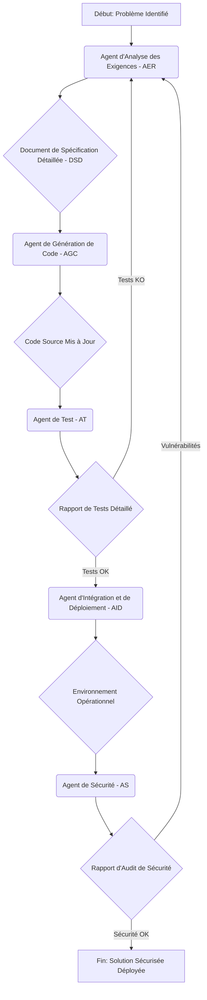

# Conception du Workflow d'Automatisation pour ProgiTresor

Ce document détaille la conception du workflow d'automatisation pour le projet ProgiTresor, en se basant sur les agents IA définis précédemment. Nous illustrerons ce workflow en nous concentrant sur un défi spécifique identifié dans l'analyse initiale : la **sécurisation des secrets hardcodés**.

## Flux Général du Workflow

Le workflow suivra une séquence d'agents, chacun prenant les livrables de l'agent précédent comme entrées, effectuant un traitement spécifique (souvent guidé par des scripts ou des prompts), et produisant de nouveaux livrables.



## Cas d'Usage : Sécurisation des Secrets Hardcodés

Nous allons détailler le fonctionnement de chaque agent pour résoudre le problème des secrets hardcodés dans le projet ProgiTresor.

### 1. Agent d'Analyse des Exigences (AER)

*   **Objectif :** Transformer le problème des secrets hardcodés en exigences claires pour leur externalisation.
*   **Entrées :**
    *   `/home/ubuntu/ProgiTresor_Analyse_Synthese.md` (Synthèse de l'analyse)
    *   `/home/ubuntu/ProgiTresor/ProgiTresor/docs/10-rapport-analyse-complete-progitresor.md` (Rapport d'audit complet)
    *   `/home/ubuntu/ProgiTresor/ProgiTresor/docker-compose.yml`
    *   `/home/ubuntu/ProgiTresor/ProgiTresor/.env.example`
*   **Processus (Prompt pour l'AER) :**
    ```text
    
Vous êtes un Agent d'Analyse des Exigences. Votre tâche est d'analyser les documents fournis pour identifier toutes les occurrences de secrets hardcodés dans le `docker-compose.yml` et les fichiers de code, et de définir des exigences claires pour leur externalisation via des variables d'environnement. Le rapport d'audit (`10-rapport-analyse-complete-progitresor.md`) mentionne spécifiquement les secrets PostgreSQL et JWT. Pour chaque secret identifié, spécifiez :
    1.  Le nom du secret.
    2.  Sa localisation actuelle (fichier et ligne si possible).
    3.  Le service ou l'application qui l'utilise.
    4.  L'exigence de transformation : comment il doit être externalisé (par exemple, `POSTGRES_PASSWORD` comme variable d'environnement).
    5.  Les critères d'acceptation pour cette transformation (par exemple, le secret n'est plus présent dans le code/fichier de configuration statique, le service démarre et fonctionne correctement avec la variable d'environnement).
    Générez un Document de Spécification Détaillée (DSD) au format Markdown.
    ```
*   **Livrables :**
    *   **Document de Spécification Détaillée (DSD) - Sécurisation des Secrets** (Markdown)

### 2. Agent de Génération de Code (AGC)

*   **Objectif :** Modifier le code et les fichiers de configuration pour externaliser les secrets identifiés par l'AER.
*   **Entrées :**
    *   DSD - Sécurisation des Secrets (de l'AER).
    *   Code source et fichiers de configuration affectés (ex: `docker-compose.yml`, `apps/services/auth-service/src/services/authService.ts`).
*   **Processus (Prompt pour l'AGC) :**
    ```text
    Vous êtes un Agent de Génération de Code. Votre tâche est de prendre le Document de Spécification Détaillée (DSD) concernant la sécurisation des secrets et d'appliquer les modifications nécessaires au code source et aux fichiers de configuration. Pour chaque secret listé dans le DSD :
    1.  Remplacez l'occurrence hardcodée par une référence à une variable d'environnement (ex: `${POSTGRES_PASSWORD}` dans `docker-compose.yml`, `process.env.JWT_SECRET` dans le code TypeScript).
    2.  Assurez-vous que les variables d'environnement sont correctement référencées dans les fichiers `.env.example` ou des fichiers de configuration similaires.
    3.  Si nécessaire, ajoutez des logiques de fallback sécurisées pour les variables d'environnement manquantes (par exemple, lancer une erreur ou utiliser une valeur par défaut non-sensible).
    4.  Générez ou mettez à jour les tests unitaires pour vérifier que les services démarrent et utilisent correctement les variables d'environnement.
    Fournissez un rapport des modifications effectuées et les extraits de code pertinents.
    ```
*   **Livrables :**
    *   **Code Source et Fichiers de Configuration Mis à Jour** (ex: `docker-compose.yml`, `authService.ts`, `.env.example`).
    *   **Tests Unitaires Mis à Jour**.
    *   **Rapport de Modifications** (Markdown).

### 3. Agent de Test (AT)

*   **Objectif :** Valider que les secrets ont été correctement externalisés et que le système fonctionne toujours comme prévu, sans régression.
*   **Entrées :**
    *   Code source et fichiers de configuration mis à jour (de l'AGC).
    *   DSD - Sécurisation des Secrets (de l'AER).
    *   Collections Postman existantes.
*   **Processus (Prompt pour l'AT) :**
    ```text
    Vous êtes un Agent de Test. Votre tâche est de valider les modifications apportées par l'Agent de Génération de Code concernant la sécurisation des secrets. Effectuez les étapes suivantes :
    1.  Déployez le projet ProgiTresor en utilisant les fichiers `docker-compose.yml` et `.env.example` mis à jour. Assurez-vous que les variables d'environnement sont correctement injectées.
    2.  Exécutez les tests unitaires et d'intégration mis à jour par l'AGC.
    3.  Exécutez un ensemble de tests de bout en bout (par exemple, via Postman) pour vérifier les fonctionnalités critiques qui dépendent des secrets (authentification, accès à la base de données).
    4.  Vérifiez que les secrets ne sont plus présents en clair dans les fichiers de configuration ou les logs après le déploiement.
    5.  Générez un Rapport de Tests Détaillé indiquant le succès ou l'échec de l'externalisation des secrets et la non-régression des fonctionnalités.
    ```
*   **Livrables :**
    *   **Rapport de Tests Détaillé - Sécurisation des Secrets** (Markdown).
    *   **Journal des Anomalies** (si applicable).

### 4. Agent d'Intégration et de Déploiement (AID)

*   **Objectif :** Déployer la version sécurisée du projet dans un environnement de pré-production ou de production.
*   **Entrées :**
    *   Code source et fichiers de configuration validés par l'AT.
    *   Rapport de Tests Détaillé (de l'AT).
*   **Processus (Prompt pour l'AID) :**
    ```text
    Vous êtes un Agent d'Intégration et de Déploiement. Votre tâche est de prendre le code validé par l'Agent de Test et de le déployer dans un environnement cible. Effectuez les étapes suivantes :
    1.  Construisez les images Docker finales en utilisant les Dockerfiles mis à jour.
    2.  Déployez le workflow en utilisant un système de gestion de secrets (par exemple, Docker Swarm Secrets, Kubernetes Secrets, HashiCorp Vault) pour injecter les variables d'environnement de manière sécurisée.
    3.  Configurez le monitoring pour les services déployés, en portant une attention particulière aux logs d'authentification et d'accès à la base de données.
    4.  Effectuez des tests de fumée post-déploiement pour confirmer que tous les services sont opérationnels.
    5.  Générez un Rapport de Déploiement confirmant le succès de l'opération et l'état de l'environnement.
    ```
*   **Livrables :**
    *   **Environnement ProgiTresor Déployé et Opérationnel**.
    *   **Rapport de Déploiement** (Markdown).

### 5. Agent de Sécurité (AS)

*   **Objectif :** Auditer la solution déployée pour s'assurer que les secrets sont correctement gérés et qu'aucune nouvelle vulnérabilité n'a été introduite.
*   **Entrées :**
    *   Environnement ProgiTresor Déployé (de l'AID).
    *   Rapport de Déploiement (de l'AID).
    *   Rapport de Tests Détaillé (de l'AT).
*   **Processus (Prompt pour l'AS) :**
    ```text
    Vous êtes un Agent de Sécurité. Votre tâche est d'auditer l'environnement ProgiTresor déployé pour vérifier la gestion des secrets. Effectuez les étapes suivantes :
    1.  Scannez l'environnement déployé pour détecter d'éventuelles fuites de secrets (par exemple, dans les variables d'environnement des conteneurs, les logs, les volumes montés).
    2.  Vérifiez que les mécanismes d'authentification (JWT) fonctionnent correctement et que les tokens sont gérés de manière sécurisée (par exemple, HttpOnly cookies pour les refresh tokens).
    3.  Confirmez que les services internes ne sont pas exposés inutilement et que les communications inter-services sont sécurisées.
    4.  Générez un Rapport d'Audit de Sécurité détaillant les findings et les recommandations, si des vulnérabilités persistent.
    ```
*   **Livrables :**
    *   **Rapport d'Audit de Sécurité - Gestion des Secrets** (Markdown).

Ce workflow, appliqué au cas de la sécurisation des secrets, démontre comment chaque agent contribue à l'amélioration continue du projet ProgiTresor, en garantissant robustesse, testabilité et prévisibilité. Des workflows similaires peuvent être conçus pour d'autres défis identifiés, tels que la correction de la Saga OT ou l'alignement Frontend/Backend.
