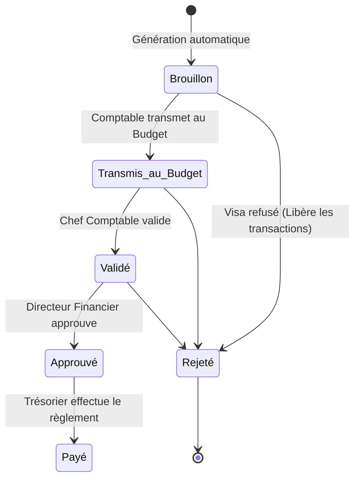

# 01 - Cahier des Charges Fonctionnel & Règles d'Analyse

Ce document compile les besoins et règles d'extraction métiers issus des documents d'origine (`ERP TRESORP PAY.pdf` et `TRESOR PAY 2024.xlsx`).

## 📋 Contexte Métier
Le projet **ProgiTresor** vise à automatiser la gestion des flux de recettes de l'Institut INFAS (droits d'inscriptions, frais de scolarité et diverses taxes annexes) issus de la plateforme gouvernementale **Trésor Pay**.

Les recettes se séparent en deux catégories majeures :
1.  **Flux Budget** : Quotes-parts de scolarité standard (inscriptions de base) liées aux promotions (L1, L2, L3, Auxiliaires).
2.  **Flux Hors Budget** : Frais annexes facturés aux étudiants (blouses blanches, trousses de stage, frais d'encadrement, cérémonies académiques). Ces flux doivent faire l'objet d'un regroupement pour émission d'un **Ordre de Traitement (OT)** vers les régies locales des antennes de l'INFAS.

---

## 🛠️ Règles d'Import & Nettoyage ETL

Lors du traitement des fichiers d'import Trésor Pay (format Excel ou CSV), le parseur applique les règles suivantes :

1.  **Nettoyage Textuel (Trim et Capitalisation)** :
    *   Les espaces indésirables en fin ou début de chaîne de caractères sur les antennes de l'INFAS doivent être retirés.
        *   *Exemple* : `"INFAS AGBOVILLE "` $\rightarrow$ `"INFAS AGBOVILLE"`.
    *   Les matricules étudiants doivent être convertis en majuscules (ex: `21p-0154asib` $\rightarrow$ `21P-0154ASIB`).
2.  **Gestion des matricules numériques ou manquants** :
    *   Certaines transactions hors-budget correspondent à des versements directs ou à des étudiants n'ayant pas encore de matricule standardisé (ex: matricule brut purement numérique comme `22666740`).
    *   L'application associe ces transactions à un profil d'étudiant générique ou laisse le champ `matricule_etudiant` à `null` afin de ne pas bloquer l'import tout en stockant le nom brut déclaré du payeur pour des fins d'audit.
3.  **Dédoublonnage strict** :
    *   Le champ `reference_tresor` sert d'identifiant unique métier. Tout doublon de référence rencontré lors d'un import est ignoré pour éviter la double comptabilisation.

---

## 🔄 Workflow des Ordres de Traitement (OT)

Le cycle de vie d'un Ordre de Traitement s'articule comme suit :

*   **Brouillon** : Le Comptable lance la génération. Les transactions hors-budget non assignées sont regroupées par **Antenne**, **Niveau** et **Type de produit**.
*   **Transmis au Budget** : Les transactions associées à l'OT sont **gelées/verrouillées**. Aucun utilisateur ne peut modifier ou supprimer une transaction gelée.
*   **Rejeté** : Si l'OT est rejeté à n'importe quelle étape de contrôle, les transactions associées sont déliées de l'OT (le verrou est levé) et redeviennent éligibles à une nouvelle consolidation.
