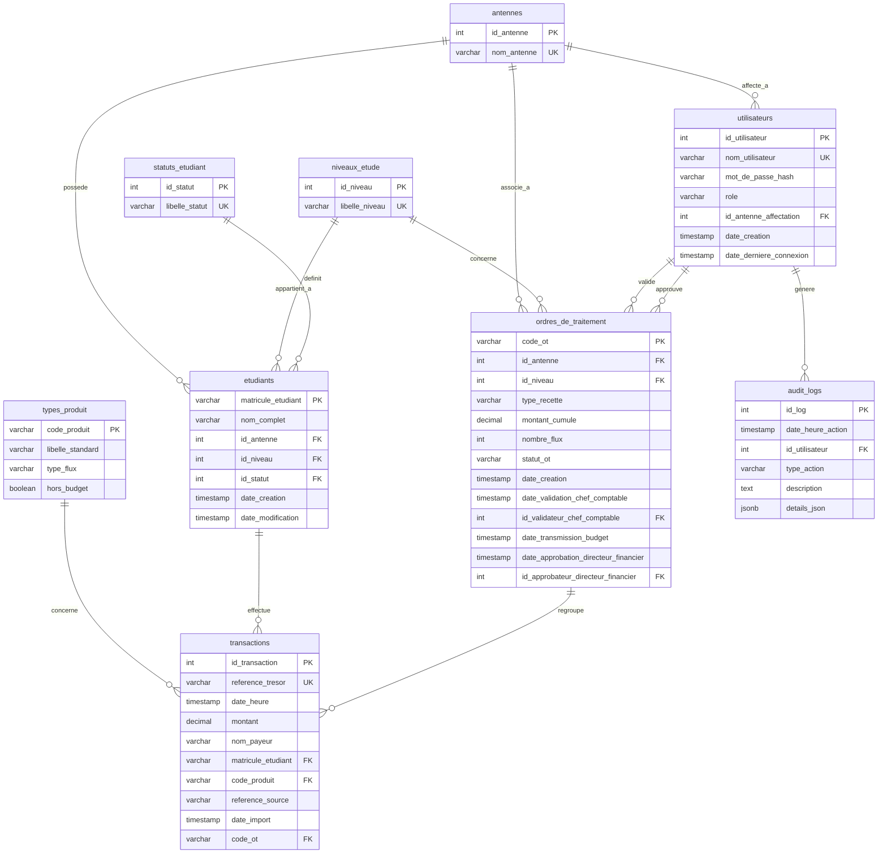

# Rapport d'Analyse des Documents et Conception de la Base de Données

Ce document présente l'analyse structurelle des fichiers sources (PDF et Excel) situés dans `~/Documents/Recette` et décrit la conception de la base de données relationnelle cible (normalisée en 3NF) destinée à l'automatisation et au suivi financier de l'ERP **Progi Teck**.

---

## 1. Analyse Structurée des Documents Sources

### 1.1 Fichiers PDF (Spécifications et Modèle de Synthèse)
Deux documents PDF ont été analysés :
1.  **`ERP TRESORP PAY.pdf`** (Cahier des charges fonctionnel et technique) :
    *   **Objectif** : Automatiser le traitement des paiements issus de la plateforme *Trésor Pay* (pour l'institut d'État INFAS) et générer des Ordres de Traitement (OT) pour les flux « Hors Budget ».
    *   **Entités identifiées** : Étudiant, Transaction, Nomenclature (Produits), Ordre de Traitement, Utilisateur et Log d'Audit.
    *   **Workflow comptable** :
        *   Le *Comptable* importe les fichiers bruts. L'ERP parse le champ `Produit Référence` pour catégoriser le flux en « Budget » (droits de scolarité/inscription par niveau) ou « Hors Budget » (frais annexes, d'encadrement, blouses, etc.).
        *   La comptabilité produit un document de synthèse agrégé (Brouillon). Le *Chef Comptable* vérifie et valide les chiffres.
        *   Le *Comptable* transmet la synthèse au service Budget (Statut : « Transmis au Budget »). Les transactions associées sont alors **gelées** (verrouillage anti-doublon).
        *   L'*Agent Budget* vérifie les enveloppes par antenne et émet l'OT officiel (ex: `OT-2024BKE-001`).
        *   Le service *Trésorerie* procède au règlement financier et génère les écritures automatiques (Débit 467/521 et Crédit 443).
2.  **`modele_synthese_ot.pdf`** (Modèle d'aide à l'établissement des OT) :
    *   Confirme la structure de regroupement de la synthèse : chaque OT regroupe les flux par **Antenne**, **Niveau** et **Type de Recette**.
    *   Fournit les comptes comptables SYSCOHADA applicables : Compte 467 (Débiteurs Divers) ou 521 (Banque) au débit, et Compte 443 (Régies d'Antennes / Fonds de tiers) au crédit.

### 1.2 Fichier Excel (`TRESOR PAY 2024.xlsx`)
L'analyse de la structure de la feuille principale `DONNEE` (151 078 lignes de transactions) révèle la structure de données suivante :

| Colonne | Nom du Champ | Rôle / Type Observé | Exemple de Valeur | Note d'Intégration / Anomalies constatées |
| :--- | :--- | :--- | :--- | :--- |
| **Col B** | `ANTENNE ` | Texte (Antenne INFAS) | `INFAS BOUAKE` | **Anomalie de doublon textuel** : Présence de `"INFAS AGBOVILLE "` (avec espace à la fin) et `"INFAS AGBOVILLE"`. Nécessite un nettoyage systématique (`TRIM`). |
| **Col C** | `REFERENCE ` | Texte (Référence de transaction) | `170790521445969` | Identifiant unique externe de transaction de paiement. Stocké en `VARCHAR(100)` ou `BIGINT`. |
| **Col D** | `PRODUIT` | Texte (Libellé produit) | `1ER VERSEMENT FRAIS DE SCOLARITE` | Catégorisé en Budget ou Hors Budget selon la nomenclature. |
| **Col E** | `MONTANT ` | Numérique (Montant payé) | `200000` | Montant financier en Francs CFA (XOF). Sans décimales en pratique, mais stocké en `DECIMAL(12,2)` pour la rigueur comptable. |
| **Col F** | `DATE ` | Date/Heure | `14/02/2024 10:07:00` | Format source standard français. Converti en `TIMESTAMP`. |
| **Col G** | `NOM PAYEUR` | Texte (Nom de l'étudiant/payeur) | `KONE DJENEBOU` | Contient parfois des caractères d'encodage altérés dans le fichier brut. |
| **Col H** | `MATRICULE` | Texte (Matricule étudiant) | `21P-0154ASIB` | Identifiant unique de l'étudiant (ex: `21P-0154ASIB`). Certains matricules pour des frais annexes sont uniquement numériques (ex: `22666740`). |
| **Col I** | `Colonne2` | Texte (Préfixe matricule) | `21P` | Préfixe extrait du matricule servant à identifier l'année et le type (ex: `21P`, `22P`, `20P`). |
| **Col J** | `MOIS` | Texte (Mois transaction) | `FÉVRIER` | Nom du mois en français. Redondant, dérivé de la date. |
| **Col K** | `Colonne1` | Numérique (Jour) | `14` | Jour du mois. Redondant, dérivé de la date. |
| **Col L, M** | `Colonne12`, `13` | - | *NULL* | 100% vides dans le fichier Excel (151 078 lignes vides). À ignorer. |

---

## 2. Conception de la Base de Données Relationnelle

Le schéma a été modélisé en **3ème Forme Normale (3NF)** pour garantir l'intégrité référentielle, éliminer les redondances de stockage et sécuriser les contrôles internes requis.

### 2.1 Liste des Tables et Dictionnaire de Données

#### 1. Table `antennes`
Représente les différentes implantations géographiques (Antennes) de l'INFAS.
*   `id_antenne` (SERIAL, PK) : Identifiant interne.
*   `nom_antenne` (VARCHAR(100), UNIQUE, NOT NULL) : Nom nettoyé de l'antenne (ex: `INFAS BOUAKE`, `INFAS AGBOVILLE`).

#### 2. Table `niveaux_etude`
Représente les promotions et cycles d'études.
*   `id_niveau` (SERIAL, PK) : Identifiant interne.
*   `libelle_niveau` (VARCHAR(50), UNIQUE, NOT NULL) : Libellé standardisé (ex: `Licence 1 (L1)`, `Licence 2 (L2)`, `Auxiliaire (A2)`).

#### 3. Table `statuts_etudiant`
Représente la situation administrative de l'élève influençant les quotes-parts de scolarité.
*   `id_statut` (SERIAL, PK) : Identifiant interne.
*   `libelle_statut` (VARCHAR(50), UNIQUE, NOT NULL) : Libellé (ex: `Public`, `Privé national`, `Non national`).

#### 4. Table `types_produit` (Nomenclature)
Table de référence pour le rapprochement et la catégorisation automatique des flux.
*   `code_produit` (VARCHAR(100), PK) : Code unique (ex: `L1_SCOL_V1`).
*   `libelle_standard` (VARCHAR(255), NOT NULL) : Libellé complet (ex: `1ER VERSEMENT FRAIS DE SCOLARITE`).
*   `type_flux` (VARCHAR(100), NOT NULL) : Classification (`Budget` ou `Hors Budget`).
*   `hors_budget` (BOOLEAN, DEFAULT FALSE) : Indicateur booléen d'exclusion budgétaire.

#### 5. Table `etudiants`
Table maîtresse contenant le référentiel des étudiants.
*   `matricule_etudiant` (VARCHAR(50), PK) : Matricule unique de l'étudiant.
*   `nom_complet` (VARCHAR(255), NOT NULL) : Nom complet.
*   `id_antenne` (INT, FK) : Antenne d'affectation. Référence `antennes(id_antenne)`.
*   `id_niveau` (INT, FK) : Niveau actuel. Référence `niveaux_etude(id_niveau)`.
*   `id_statut` (INT, FK) : Statut légal. Référence `statuts_etudiant(id_statut)`.
*   `date_creation` (TIMESTAMP) : Date d'intégration initiale.
*   `date_modification` (TIMESTAMP) : Date de mise à jour.

#### 6. Table `utilisateurs`
Gère les comptes d'accès à l'application Progi Teck avec cloisonnement des tâches.
*   `id_utilisateur` (SERIAL, PK) : Identifiant utilisateur.
*   `nom_utilisateur` (VARCHAR(100), UNIQUE, NOT NULL) : Identifiant de connexion.
*   `mot_de_passe_hash` (VARCHAR(255), NOT NULL) : Hash sécurisé.
*   `role` (VARCHAR(50), NOT NULL) : Rôle d'accès (`Administrateur`, `Comptable`, `Agent Budget`, `Chef Comptable`, `Directeur Financier`, `Consultant`).
*   `id_antenne_affectation` (INT, FK, NULL) : Antenne associée (si profil local). Référence `antennes(id_antenne)`.
*   `date_creation` (TIMESTAMP) : Date de création du compte.
*   `date_derniere_connexion` (TIMESTAMP, NULL) : Dernière connexion réussie de l'utilisateur.

#### 7. Table `ordres_de_traitement` (OT)
Entité centrale du workflow d'ordonnancement. Chaque enregistrement représente une ligne de synthèse consolidée prête à être liquidée.
*   `code_ot` (VARCHAR(100), PK) : Numéro officiel de l'OT généré (ex: `OT-2024ABJ-001`).
*   `id_antenne` (INT, FK, NOT NULL) : Régie antenne réceptrice. Référence `antennes(id_antenne)`.
*   `id_niveau` (INT, FK, NOT NULL) : Niveau ciblé. Référence `niveaux_etude(id_niveau)`.
*   `type_recette` (VARCHAR(100), NOT NULL) : Type de produit agrégé (ex: `Blouses Blanches`).
*   `montant_cumule` (DECIMAL(12,2), NOT NULL) : Somme consolidée des paiements.
*   `nombre_flux` (INT, NOT NULL) : Nombre de transactions individuelles agrégées.
*   `statut_ot` (VARCHAR(50), DEFAULT 'Brouillon') : Cycle de vie (`Brouillon`, `Transmis au Budget`, `Validé`, `Approuvé`, `Rejeté`, `Payé`).
*   `date_creation` (TIMESTAMP) : Date d'initialisation de l'OT par le comptable.
*   `date_validation_chef_comptable` (TIMESTAMP, NULL) : Date de visa du Chef Comptable.
*   `id_validateur_chef_comptable` (INT, FK, NULL) : Référence `utilisateurs(id_utilisateur)`.
*   `date_transmission_budget` (TIMESTAMP, NULL) : Date d'envoi à l'ordonnancement.
*   `date_approbation_directeur_financier` (TIMESTAMP, NULL) : Date de visa final du Directeur Financier.
*   `id_approbateur_directeur_financier` (INT, FK, NULL) : Référence `utilisateurs(id_utilisateur)`.

#### 8. Table `transactions`
Enregistre chaque encaissement brut importé depuis Trésor Pay ou extrait de PDF.
*   `id_transaction` (SERIAL, PK) : Identifiant transactionnel.
*   `reference_tresor` (VARCHAR(100), UNIQUE, NOT NULL) : Référence unique Trésor Pay (ex: `170790521445969`).
*   `date_heure` (TIMESTAMP, NOT NULL) : Date d'exécution du paiement.
*   `montant` (DECIMAL(12,2), NOT NULL) : Valeur faciale en Francs CFA.
*   `nom_payeur` (VARCHAR(255)) : Identité déclarée du payeur.
*   `matricule_etudiant` (VARCHAR(50), FK, NULL) : Lien étudiant. Référence `etudiants(matricule_etudiant)`.
*   `code_produit` (VARCHAR(100), FK, NULL) : Lien nomenclature. Référence `types_produit(code_produit)`.
*   `reference_source` (VARCHAR(255)) : Nom du fichier d'import pour audit.
*   `date_import` (TIMESTAMP) : Horodatage d'importation dans Progi Teck.
*   `code_ot` (VARCHAR(100), NULL) : Référence logique vers l'OT d'agrégation (`ordres_de_traitement.code_ot`). En microservices, ce lien reste textuel et sans FK physique entre bases.

#### 9. Table `audit_logs`
Sécurise la traçabilité des opérations sensibles (Imports, validations, modifications d'OT).
*   `id_log` (SERIAL, PK) : Clé technique.
*   `date_heure_action` (TIMESTAMP) : Horodatage.
*   `id_utilisateur` (INT, FK) : Auteur. Référence `utilisateurs(id_utilisateur)`.
*   `type_action` (VARCHAR(100), NOT NULL) : Type (ex: `IMPORT_EXCEL`, `VALIDATION_OP`).
*   `description` (TEXT) : Récit d'opération.
*   `details_json` (JSONB, NULL) : Stockage extensible des détails de modification (anciennes / nouvelles valeurs).

---

## 3. Diagramme de Relations d'Entités (Mermaid)

Le diagramme ci-dessous illustre la structure des tables, les clés primaires (PK), clés étrangères (FK) et les multiplicités des associations.



---

## 4. Script SQL DDL de Création (PostgreSQL)

Voici le script SQL validé permettant de déployer la base de données. Il contient la création des tables, les contraintes d'intégrité, les index de performance et les triggers pour geler les transactions liées à un OT transmis.

```sql
-- ===========================================================================
-- SCRIPT DE CREATION DE LA BASE DE DONNEES (PROGI TECK / INFAS RECETTES)
-- SGBD CIBLE : PostgreSQL
-- ===========================================================================

-- ---------------------------------------------------------------------------
-- 1. Nettoyage de l'existant (Ordre inverse des dependances)
-- ---------------------------------------------------------------------------
DROP TABLE IF EXISTS audit_logs CASCADE;
DROP TABLE IF EXISTS transactions CASCADE;
DROP TABLE IF EXISTS ordres_de_traitement CASCADE;
DROP TABLE IF EXISTS etudiants CASCADE;
DROP TABLE IF EXISTS types_produit CASCADE;
DROP TABLE IF EXISTS statuts_etudiant CASCADE;
DROP TABLE IF EXISTS niveaux_etude CASCADE;
DROP TABLE IF EXISTS utilisateurs CASCADE;
DROP TABLE IF EXISTS antennes CASCADE;

-- ---------------------------------------------------------------------------
-- 2. Creation des tables de reference
-- ---------------------------------------------------------------------------

-- Table: antennes
CREATE TABLE antennes (
    id_antenne SERIAL PRIMARY KEY,
    nom_antenne VARCHAR(100) UNIQUE NOT NULL
);

-- Table: niveaux_etude
CREATE TABLE niveaux_etude (
    id_niveau SERIAL PRIMARY KEY,
    libelle_niveau VARCHAR(50) UNIQUE NOT NULL
);

-- Table: statuts_etudiant
CREATE TABLE statuts_etudiant (
    id_statut SERIAL PRIMARY KEY,
    libelle_statut VARCHAR(50) UNIQUE NOT NULL
);

-- Table: types_produit (Nomenclature interne de rapprochement)
CREATE TABLE types_produit (
    code_produit VARCHAR(100) PRIMARY KEY,
    libelle_standard VARCHAR(255) NOT NULL,
    type_flux VARCHAR(100) NOT NULL,
    hors_budget BOOLEAN DEFAULT FALSE,
    CONSTRAINT chk_type_flux CHECK (type_flux IN ('Budget', 'Hors Budget'))
);

-- ---------------------------------------------------------------------------
-- 3. Creation des tables maîtresses
-- ---------------------------------------------------------------------------

-- Table: etudiants
CREATE TABLE etudiants (
    matricule_etudiant VARCHAR(50) PRIMARY KEY,
    nom_complet VARCHAR(255) NOT NULL,
    id_antenne INT REFERENCES antennes(id_antenne) ON DELETE SET NULL,
    id_niveau INT REFERENCES niveaux_etude(id_niveau) ON DELETE SET NULL,
    id_statut INT REFERENCES statuts_etudiant(id_statut) ON DELETE SET NULL,
    date_creation TIMESTAMP DEFAULT CURRENT_TIMESTAMP,
    date_modification TIMESTAMP DEFAULT CURRENT_TIMESTAMP
);

-- Table: utilisateurs (Rôles Applicatifs et RBAC)
CREATE TABLE utilisateurs (
    id_utilisateur SERIAL PRIMARY KEY,
    nom_utilisateur VARCHAR(100) UNIQUE NOT NULL,
    mot_de_passe_hash VARCHAR(255) NOT NULL,
    role VARCHAR(50) NOT NULL,
    id_antenne_affectation INT REFERENCES antennes(id_antenne) ON DELETE SET NULL,
    date_creation TIMESTAMP DEFAULT CURRENT_TIMESTAMP,
    date_derniere_connexion TIMESTAMP,
    CONSTRAINT chk_role CHECK (role IN (
        'Administrateur', 'Comptable', 'Agent Budget', 
        'Consultant', 'Chef Comptable', 'Directeur Financier'
    ))
);

-- ---------------------------------------------------------------------------
-- 4. Creation des tables transactionnelles et de workflow
-- ---------------------------------------------------------------------------

-- Table: ordres_de_traitement (OT)
CREATE TABLE ordres_de_traitement (
    code_ot VARCHAR(100) PRIMARY KEY,
    id_antenne INT NOT NULL REFERENCES antennes(id_antenne),
    id_niveau INT NOT NULL REFERENCES niveaux_etude(id_niveau),
    type_recette VARCHAR(100) NOT NULL,
    montant_cumule DECIMAL(12, 2) NOT NULL DEFAULT 0.00,
    nombre_flux INT NOT NULL DEFAULT 0,
    statut_ot VARCHAR(50) NOT NULL DEFAULT 'Brouillon',
    date_creation TIMESTAMP DEFAULT CURRENT_TIMESTAMP,
    date_validation_chef_comptable TIMESTAMP,
    id_validateur_chef_comptable INT REFERENCES utilisateurs(id_utilisateur) ON DELETE SET NULL,
    date_transmission_budget TIMESTAMP,
    date_approbation_directeur_financier TIMESTAMP,
    id_approbateur_directeur_financier INT REFERENCES utilisateurs(id_utilisateur) ON DELETE SET NULL,
    CONSTRAINT chk_statut_ot CHECK (statut_ot IN (
        'Brouillon', 'Transmis au Budget', 'Validé', 'Approuvé', 'Rejeté', 'Payé'
    )),
    CONSTRAINT chk_montant_op CHECK (montant_cumule >= 0),
    CONSTRAINT chk_nombre_flux CHECK (nombre_flux >= 0)
);

-- Table: transactions (Lignes de paiement importees)
CREATE TABLE transactions (
    id_transaction SERIAL PRIMARY KEY,
    reference_tresor VARCHAR(100) UNIQUE NOT NULL,
    date_heure TIMESTAMP NOT NULL,
    montant DECIMAL(12, 2) NOT NULL,
    nom_payeur VARCHAR(255),
    matricule_etudiant VARCHAR(50) REFERENCES etudiants(matricule_etudiant) ON DELETE SET NULL,
    code_produit VARCHAR(100) REFERENCES types_produit(code_produit) ON DELETE SET NULL,
    reference_source VARCHAR(255),
    date_import TIMESTAMP DEFAULT CURRENT_TIMESTAMP,
    code_ot VARCHAR(100) REFERENCES ordres_de_traitement(code_ot) ON DELETE SET NULL,
    CONSTRAINT chk_montant_tx CHECK (montant >= 0)
);

-- Table: audit_logs (Journalisation de securite)
CREATE TABLE audit_logs (
    id_log SERIAL PRIMARY KEY,
    date_heure_action TIMESTAMP DEFAULT CURRENT_TIMESTAMP,
    id_utilisateur INT REFERENCES utilisateurs(id_utilisateur) ON DELETE SET NULL,
    type_action VARCHAR(100) NOT NULL,
    description TEXT,
    details_json JSONB
);

-- ---------------------------------------------------------------------------
-- 5. Creation des Index de Performance
-- ---------------------------------------------------------------------------
-- Indexation des cles etrangeres et colonnes de filtres pour optimiser
-- la performance des requêtes analytiques sur les 151 000+ lignes.

CREATE INDEX idx_transactions_matricule ON transactions(matricule_etudiant);
CREATE INDEX idx_transactions_produit ON transactions(code_produit);
CREATE INDEX idx_transactions_op ON transactions(code_ot);
CREATE INDEX idx_transactions_date ON transactions(date_heure);
CREATE INDEX idx_etudiants_antenne ON etudiants(id_antenne);
CREATE INDEX idx_etudiants_niveau ON etudiants(id_niveau);
CREATE INDEX idx_etudiants_statut ON etudiants(id_statut);
CREATE INDEX idx_utilisateurs_role ON utilisateurs(role);
CREATE INDEX idx_utilisateurs_antenne ON utilisateurs(id_antenne_affectation);
CREATE INDEX idx_utilisateurs_derniere_connexion ON utilisateurs(date_derniere_connexion);
CREATE INDEX idx_op_antenne ON ordres_de_traitement(id_antenne);
CREATE INDEX idx_op_niveau ON ordres_de_traitement(id_niveau);
CREATE INDEX idx_op_antenne_niveau ON ordres_de_traitement(id_antenne, id_niveau);
CREATE INDEX idx_op_statut ON ordres_de_traitement(statut_ot);
CREATE INDEX idx_audit_user ON audit_logs(id_utilisateur);
CREATE INDEX idx_audit_action ON audit_logs(type_action);

-- ---------------------------------------------------------------------------
-- 6. Trigger de gelification des transactions
-- ---------------------------------------------------------------------------
-- Cette fonction trigger empêche la modification ou suppression d'une
-- transaction dès lors que son OT associe n'est plus au statut Brouillon.

CREATE OR REPLACE FUNCTION verifier_gel_transaction()
RETURNS TRIGGER AS $$
DECLARE
    v_statut TEXT;
    v_ordre_traitement_id INTEGER;
BEGIN
    v_ordre_traitement_id := COALESCE(
        OLD.ordre_traitement_id,
        CASE WHEN TG_OP = 'UPDATE' THEN NEW.ordre_traitement_id ELSE NULL END
    );

    IF v_ordre_traitement_id IS NULL THEN
        RETURN COALESCE(NEW, OLD);
    END IF;

    SELECT statut INTO v_statut
    FROM ordre_traitement_miroir
    WHERE id = v_ordre_traitement_id;

    IF v_statut IS NOT NULL AND v_statut <> 'Brouillon' THEN
        -- Allow updates that ONLY change administrative fields
        -- (statut_traitement and/or gele) without touching financial data.
        -- This enables the "Transmettre au Budget" workflow.
        IF TG_OP = 'UPDATE'
           AND OLD.ordre_traitement_id IS NOT DISTINCT FROM NEW.ordre_traitement_id
           AND OLD.montant IS NOT DISTINCT FROM NEW.montant
           AND OLD.ref_tresor IS NOT DISTINCT FROM NEW.ref_tresor
           AND OLD.etudiant_id IS NOT DISTINCT FROM NEW.etudiant_id
           AND OLD.antenne_id IS NOT DISTINCT FROM NEW.antenne_id
           AND OLD.nomenclature_id IS NOT DISTINCT FROM NEW.nomenclature_id
           AND OLD.date_heure IS NOT DISTINCT FROM NEW.date_heure
        THEN
            RETURN NEW;
        END IF;

        RAISE EXCEPTION
            'Modification refusee : la transaction % est gelee car l''Ordre de Traitement % est au statut %.',
            OLD.id, v_ordre_traitement_id, v_statut;
    END IF;

    RETURN COALESCE(NEW, OLD);
END;
$$ LANGUAGE plpgsql;

DROP TRIGGER IF EXISTS trg_verifier_gel_transaction ON transactions;

CREATE TRIGGER trg_verifier_gel_transaction
BEFORE UPDATE OR DELETE ON transactions
FOR EACH ROW
EXECUTE FUNCTION verifier_gel_transaction();

-- ---------------------------------------------------------------------------
-- 7. Creation des Vues Metier (Analytiques)
-- ---------------------------------------------------------------------------

-- Vue: vue_solde_etudiant (Cumul des versements par etudiant)
CREATE OR REPLACE VIEW vue_solde_etudiant AS
SELECT 
    e.matricule_etudiant,
    e.nom_complet,
    a.nom_antenne,
    n.libelle_niveau,
    s.libelle_statut,
    COALESCE(SUM(t.montant), 0) AS total_paye
FROM etudiants e
LEFT JOIN antennes a ON e.id_antenne = a.id_antenne
LEFT JOIN niveaux_etude n ON e.id_niveau = n.id_niveau
LEFT JOIN statuts_etudiant s ON e.id_statut = s.id_statut
LEFT JOIN transactions t ON e.matricule_etudiant = t.matricule_etudiant
GROUP BY e.matricule_etudiant, e.nom_complet, a.nom_antenne, n.libelle_niveau, s.libelle_statut;

-- Vue: vue_synthese_ot (Visualisation de la synthese avant generation d'OT)
CREATE OR REPLACE VIEW vue_synthese_ot AS
SELECT 
    a.nom_antenne,
    n.libelle_niveau,
    tp.libelle_standard AS type_recette,
    SUM(t.montant) AS montant_cumule,
    COUNT(t.id_transaction) AS nombre_flux
FROM transactions t
JOIN etudiants e ON t.matricule_etudiant = e.matricule_etudiant
JOIN antennes a ON e.id_antenne = a.id_antenne
JOIN niveaux_etude n ON e.id_niveau = n.id_niveau
JOIN types_produit tp ON t.code_produit = tp.code_produit
WHERE tp.hors_budget = TRUE AND t.code_ot IS NULL
GROUP BY a.nom_antenne, n.libelle_niveau, tp.libelle_standard;
```

---

## 5. Trigger de gélification des transactions

Le trigger `verifier_gel_transaction` est installé dans la base du `transaction-service` via les migrations Prisma. Il empêche toute modification ou suppression des **champs financiers** d'une transaction dès que l'OT lié n'est plus au statut `Brouillon`. Les mises à jour **administratives** (uniquement `statut_traitement` et `gele`) sont cependant autorisées pour permettre le workflow « Transmettre au Budget » — le trigger vérifie que les champs sensibles (`montant`, `ref_tresor`, `etudiant_id`, `antenne_id`, `nomenclature_id`, `date_heure`, `ordre_traitement_id`) restent identiques avant d'autoriser l'opération.

Dans le déploiement microservices, `ordre_traitement_id` est une référence entière sans FK physique vers la base du `order-service`. Pour permettre au trigger PostgreSQL de vérifier le statut localement, le `transaction-service` maintient un miroir minimal `ordre_traitement_miroir(id, code_ot, statut)`. Le `order-service` synchronise ce miroir via l'endpoint interne `PUT /ot-status` après chaque changement de statut d'OT.

Cette approche conserve le découpage base-par-service tout en appliquant la règle métier au plus près des données transactionnelles.

---

## 6. Recommandations d'Intégration et Qualité des Données

Lors de l'implémentation de la procédure d'importation dans Progi Teck, nous conseillons d'appliquer les règles de nettoyage de données suivantes basées sur les anomalies observées dans le fichier Excel source :
1.  **Nettoyage Textuel (Trim et Capitalisation)** :
    *   Les noms d'antennes doivent systématiquement être débarrassés de leurs espaces de fin. Par exemple, `"INFAS AGBOVILLE "` doit être converti en `"INFAS AGBOVILLE"`.
    *   Les matricules doivent être convertis en majuscules (ex: `21p-0154asib` -> `21P-0154ASIB`).
2.  **Gestion des matricules temporaires/inconnus** :
    *   Pour les transactions liées à des matricules purement numériques (qui correspondent souvent à des paiements hors-budget directs par téléphone ou des inscrits temporaires), l'application doit créer un enregistrement étudiant par défaut (profil "Inconnu" ou "Temporaire") ou laisser la clé étrangère `matricule_etudiant` à *NULL* tout en conservant le `nom_payeur` brut dans la transaction pour l'audit.
3.  **Encodage des caractères** :
    *   Le parseur Python doit décoder les fichiers en forçant le format UTF-8 ou en remplaçant les caractères indéchiffrables (`errors='replace'`) afin d'éviter les crashs lors de l'insertion des colonnes textuelles comme `nom_payeur` (qui contient des caractères spéciaux mal encodés dans l'Excel source).
