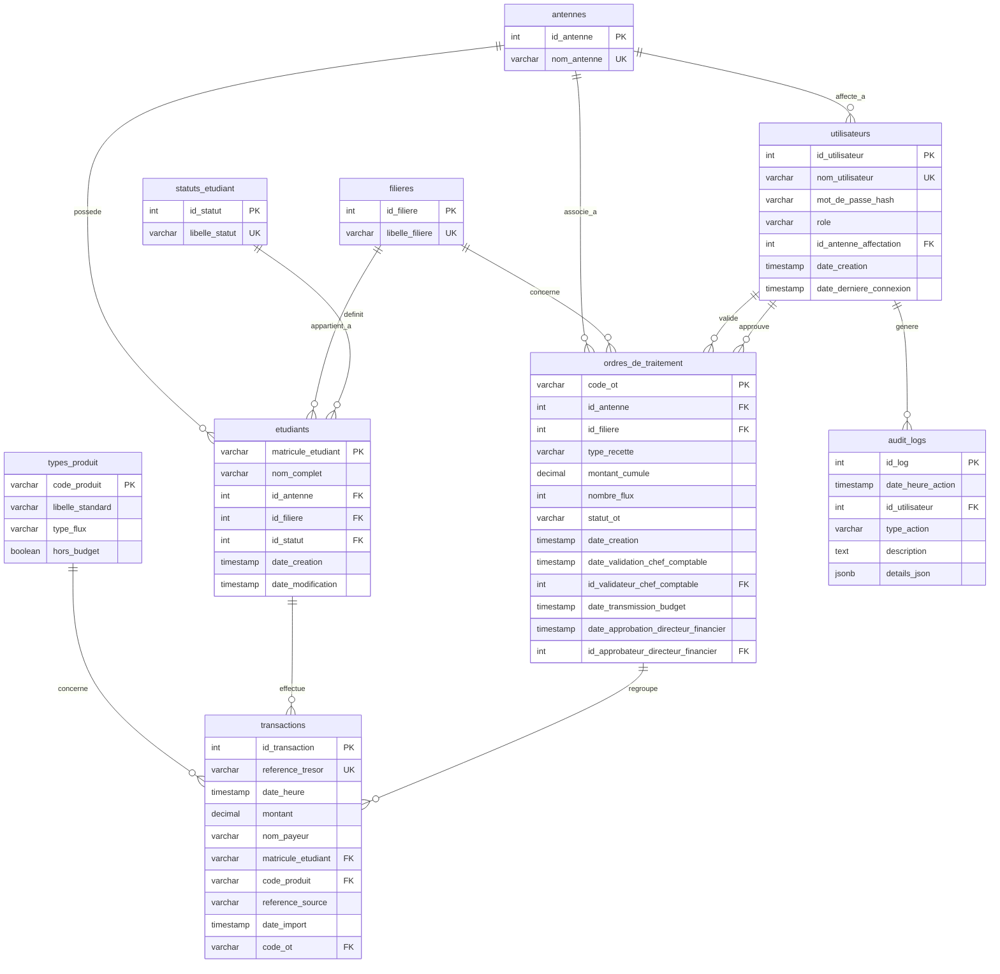

# 02 - Diagramme ER (Relations d'Entités)

Ce diagramme illustre le modèle relationnel cible 3NF de ProgiTresor. Dans le monorepo microservices, certaines relations inter-services sont portées comme références logiques sans FK physique entre bases, notamment `transactions.code_ot`.

